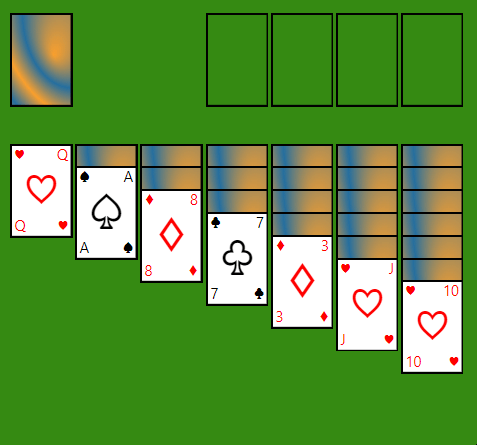

# Solitaire

[Solitaire build is available here](https://jani-e.fly.dev/build/solitaire)

## Version history

### 1.2.0
* Added game scoring for moves
* Added count up timer for the game duration
* Added victory modal when game is finished
* Updated visual styling

### 1.1.0
* Undo -feature added
* Adjusted view scaling

### 1.0.0
* MVP version of Solitaire Klondike
* Preview:

